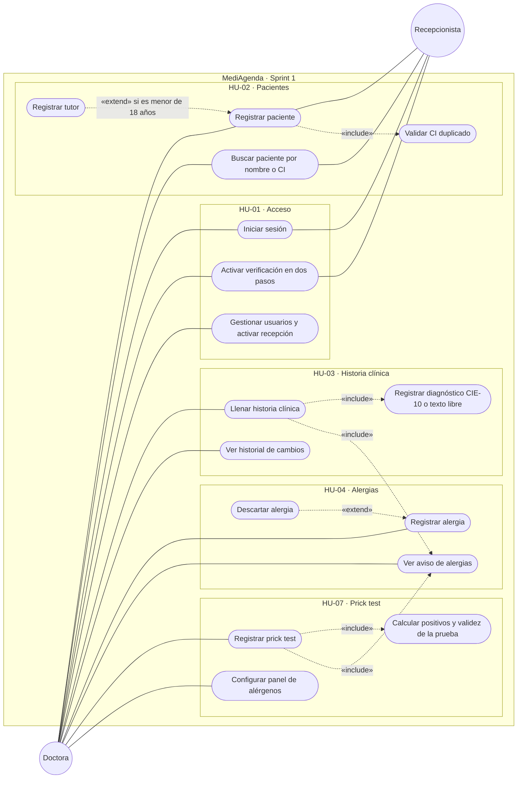

# Diagrama de casos de uso · Sprint 1

Historias HU-01, HU-02, HU-03, HU-04 y HU-07. La recepcionista solo llega a los casos de uso de pacientes y acceso; todo lo clínico es exclusivo de la doctora.

| Caso de uso | Actor | Historia | Regla principal |
|---|---|---|---|
| Iniciar sesión | Doctora, recepcionista | HU-01 | Solo entran usuarios activos |
| Gestionar usuarios | Doctora | HU-01 | Los usuarios no se borran: se desactivan |
| Registrar paciente | Doctora, recepcionista | HU-02 | CI único (con complemento); tutor obligatorio si es menor |
| Llenar historia clínica | Doctora | HU-03 | Apartados de la NOM-004; cada cambio queda en la auditoría |
| Registrar alergia | Doctora | HU-04 | Una alergia errónea se descarta, no se borra |
| Registrar prick test | Doctora | HU-07 | Positivo si la pápula supera al control negativo en el criterio o más |
