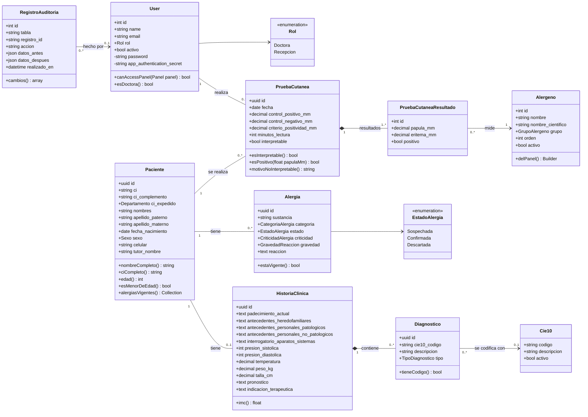

# Diagrama de clases · Expediente del paciente

Modelos de Laravel del Sprint 1 (`app/Models`). Los métodos son los que contienen reglas del negocio; los campos de control (`created_at`, `updated_at`, `deleted_at`, `created_by`, `updated_by`) se omiten para que el diagrama se lea mejor.

**Reglas que viven en los modelos:**

- `PruebaCutanea::esInterpretable()`: la histamina debe reaccionar (pápula ≥ criterio) y la solución salina no (pápula < criterio).
- `PruebaCutanea::esPositivo()`: la pápula del alérgeno supera al control negativo en el criterio o más (3 mm por defecto).
- `PruebaCutaneaResultado` calcula `positivo` al guardarse; si cambian los controles, la prueba recalcula todos sus resultados.
- `RegistroAuditoria` no tiene métodos para escribir: la tabla la llenan los triggers de la base.
