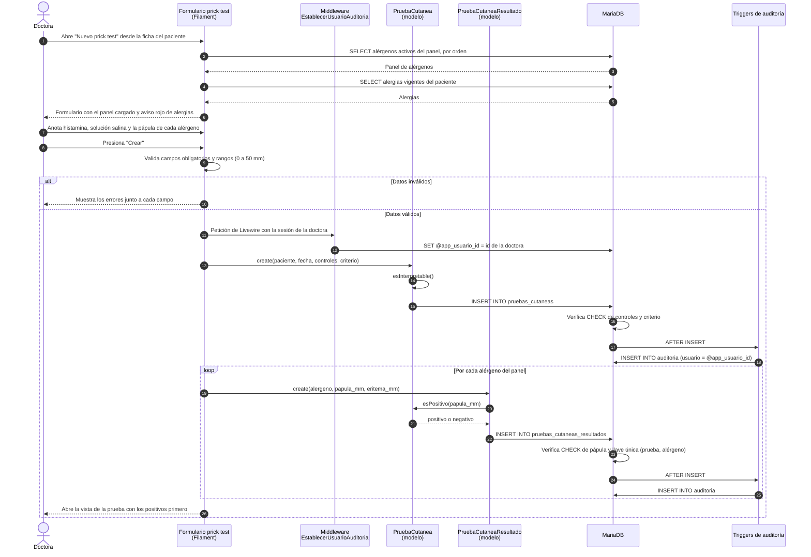

# Diagrama de secuencia · Registrar un prick test (HU-07)

Desde que la doctora abre el formulario hasta que la prueba queda guardada y auditada.

**Puntos de seguridad en el flujo:**

1. El usuario de base de datos de la aplicación (`mediagenda_app`) solo puede hacer `SELECT`, `INSERT` y `UPDATE` en estas tablas: un resultado guardado no se puede borrar.
2. Las restricciones `CHECK` repiten en la base las validaciones del formulario, por si alguien escribe directo en phpMyAdmin.
3. La auditoría la escriben los triggers con los permisos del usuario migrador; la aplicación no puede modificarla.
