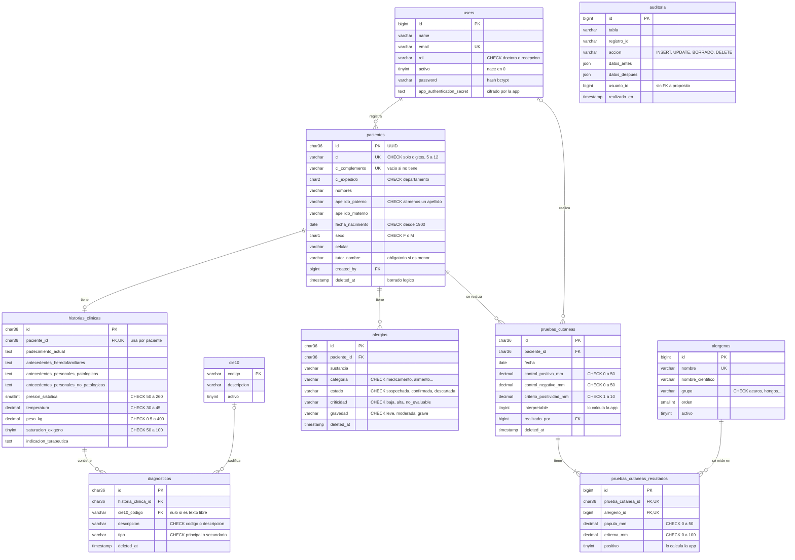

# Diagrama entidad-relación · Base `mediagenda` (MariaDB)

Tablas del Sprint 1 tal como las crean las migraciones. `PK` = llave primaria, `FK` = llave foránea, `UK` = único. Los comentarios indican la restricción `CHECK` o la regla de la columna. Todas las llaves foráneas usan `ON DELETE RESTRICT`.

## Seguridad en la base

| Objeto | Qué hace |
|---|---|
| Usuario `mediagenda_migrador` | Crea y modifica la estructura. No puede dar permisos. |
| Usuario `mediagenda_app` | `SELECT`, `INSERT`, `UPDATE` en las tablas clínicas; **sin `DELETE`** ni cambios de estructura. Solo `SELECT` en `cie10` y `auditoria`. |
| 24 triggers `trg_<tabla>_auditoria_*` | Copian cada `INSERT`, `UPDATE` y `DELETE` de 8 tablas a `auditoria`, con el usuario de `@app_usuario_id`. |
| `trg_auditoria_sin_cambios` y `trg_auditoria_sin_borrado` | Impiden modificar o borrar la auditoría, incluso al migrador. |
| 28 restricciones `CHECK` | Repiten en la base las reglas del formulario (rangos, listas de valores, formato del CI). |

La tabla `auditoria` no tiene llave foránea hacia `users` a propósito: la bitácora no debe depender de que el usuario siga existiendo. Los scripts de usuarios y permisos están en `database/sql/`.
