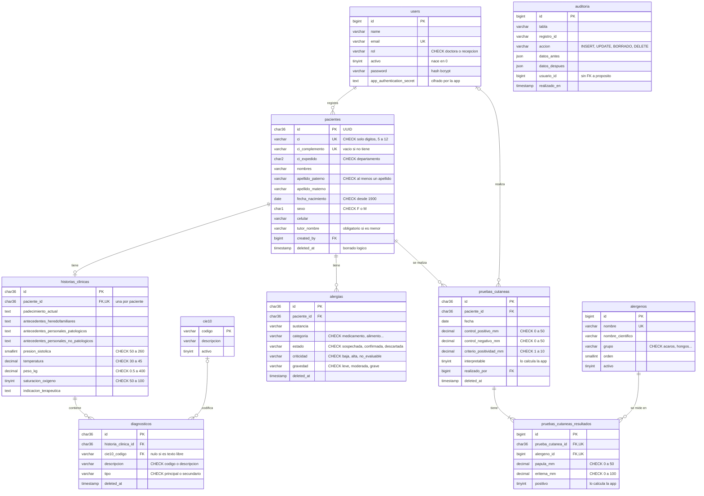
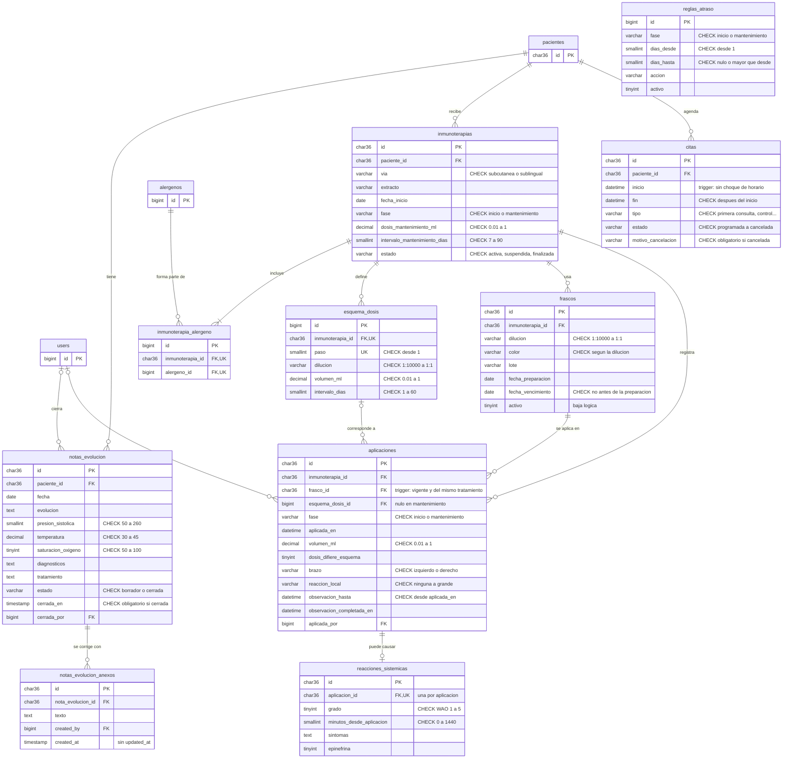

# Diagrama entidad-relación · Base `mediagenda` (MariaDB)

Tablas tal como las crean las migraciones. `PK` = llave primaria, `FK` = llave foránea, `UK` = único. Los comentarios indican la restricción `CHECK` o la regla de la columna. Todas las llaves foráneas usan `ON DELETE RESTRICT`.

## Sprint 1 · Expediente del paciente

## Sprint 2 · Notas de evolución, inmunoterapia y agenda

`pacientes`, `users` y `alergenos` son las tablas del Sprint 1; aquí solo se muestran sus llaves.

**Vistas:**

- `v_proxima_aplicacion`: por cada inmunoterapia activa y subcutánea, la última aplicación y la fecha prevista de la siguiente (intervalo del paso o del mantenimiento).
- `v_pacientes_atrasados`: las de `v_proxima_aplicacion` cuya fecha prevista ya pasó, con los días de atraso (`DATEDIFF`).

## Seguridad en la base

| Objeto | Qué hace |
|---|---|
| Usuario `mediagenda_migrador` | Crea y modifica la estructura. No puede dar permisos. |
| Usuario `mediagenda_app` | `SELECT`, `INSERT`, `UPDATE` en las tablas clínicas; **sin `DELETE`** ni cambios de estructura. Solo `SELECT` en `cie10`, `auditoria` y las vistas. En los anexos solo `SELECT` e `INSERT`. Entre las tablas clínicas solo puede borrar filas de `esquema_dosis` e `inmunoterapia_alergeno`, protegidas por las llaves foráneas y auditadas (las tablas internas de Laravel, como `sessions` y `cache`, sí admiten `DELETE`). |
| 54 triggers `trg_<tabla>_auditoria_*` | Copian cada `INSERT`, `UPDATE` y `DELETE` de 18 tablas a `auditoria`, con el usuario de `@app_usuario_id`. |
| `trg_auditoria_sin_cambios` y `trg_auditoria_sin_borrado` | Impiden modificar o borrar la auditoría, incluso al migrador. |
| `trg_notas_evolucion_bloqueo_update` y `_delete` | Una nota cerrada no se modifica ni se borra. |
| `trg_anexos_solo_nota_cerrada` | Los anexos solo se agregan a notas cerradas. |
| `trg_aplicaciones_validar_frasco` | Rechaza frascos vencidos, dados de baja o de otro tratamiento. |
| `trg_citas_sin_choque_insert` y `_update` | Rechazan citas vigentes que se cruzan con otra. |
| 65 restricciones `CHECK` | Repiten en la base las reglas del formulario (rangos, listas de valores, formato del CI, color del frasco según la dilución). |

El script `database/sql/03_verificar_reglas_sprint_2.sql` prueba estas reglas con el usuario de la aplicación.

La tabla `auditoria` no tiene llave foránea hacia `users` a propósito: la bitácora no debe depender de que el usuario siga existiendo. Los scripts de usuarios y permisos están en `database/sql/`.
