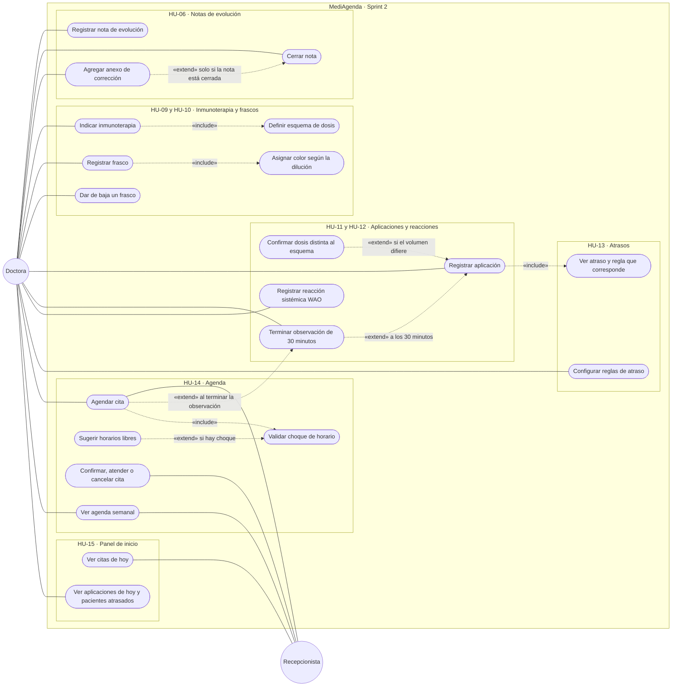

# Diagrama de casos de uso · Sprint 2

Historias HU-06 y HU-09 a HU-15. La recepcionista maneja la agenda y ve las citas del día; la inmunoterapia, las notas de evolución y las reglas de atraso son exclusivas de la doctora.

| Caso de uso | Actor | Historia | Regla principal |
|---|---|---|---|
| Cerrar nota | Doctora | HU-06 | Una nota cerrada no se modifica ni se borra; un trigger lo impide en la base |
| Agregar anexo | Doctora | HU-06 | Solo en notas cerradas; los anexos no se editan |
| Registrar frasco | Doctora | HU-10 | El color lo fija la dilución (plata, verde, azul, amarillo, rojo) |
| Registrar aplicación | Doctora | HU-11 | Solo frascos vigentes del mismo tratamiento; la dosis distinta al esquema se confirma |
| Terminar observación | Doctora | HU-11 | Se habilita a los 30 minutos y sugiere la fecha de la siguiente dosis |
| Registrar reacción sistémica | Doctora | HU-12 | Escala WAO de 1 a 5; se avisa en la siguiente aplicación |
| Configurar reglas de atraso | Doctora | HU-13 | Tramos de días de atraso por fase; los ejemplos de la ACAAI los revisa la doctora |
| Agendar cita | Doctora, recepcionista | HU-14 | Dos citas vigentes no pueden cruzarse; se sugieren horarios libres |
| Cancelar cita | Doctora, recepcionista | HU-14 | Pide motivo; la cita queda en el historial, no se borra |
| Panel de inicio | Doctora, recepcionista | HU-15 | La recepción solo ve las citas; lo clínico es de la doctora |
