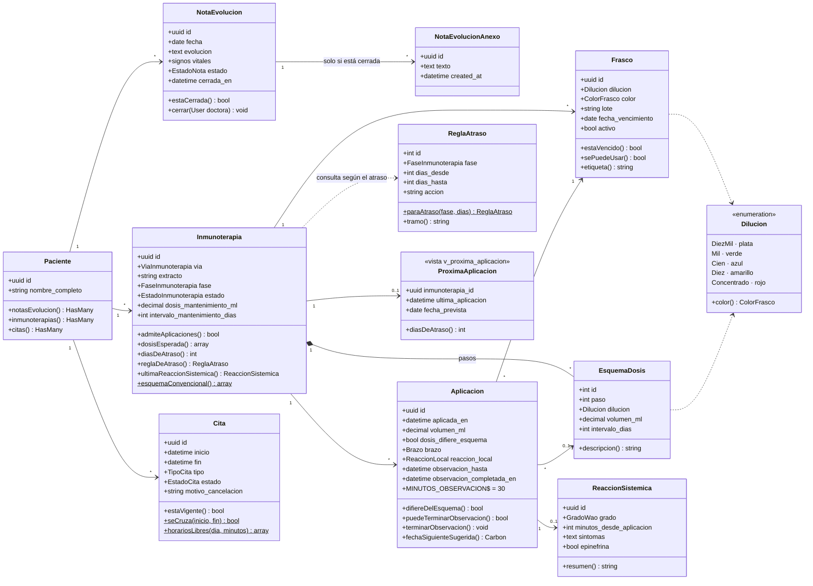

# Diagrama de clases · Inmunoterapia, notas y agenda

Modelos de Laravel del Sprint 2 (`app/Models`). Se muestran los métodos que contienen reglas del negocio; los campos de control (`created_at`, `updated_at`, `created_by`, `updated_by`) se omiten.

**Reglas que viven en los modelos:**

- `Inmunoterapia::dosisEsperada()`: en la fase de inicio es el paso siguiente al último aplicado; en mantenimiento, la dosis de mantenimiento del frasco concentrado (1:1).
- `Inmunoterapia::esquemaConvencional()`: plantilla editable de 0.05 a 0.50 mL por frasco, una vez por semana; la doctora la ajusta para cada paciente.
- `Frasco` fija su color al guardarse según la dilución; `sePuedeUsar()` exige que esté activo y sin vencer.
- `Aplicacion` calcula al crearse el fin de la observación (30 minutos) y si la dosis difiere del esquema.
- `ProximaAplicacion` es un modelo de solo lectura sobre la vista `v_proxima_aplicacion`: la fecha prevista se calcula en la base.
- `Cita::seCruza()` ignora las citas canceladas y las de pacientes que no asistieron; `horariosLibres()` recorre la jornada (08:00 a 19:00) en tramos de 15 minutos.
