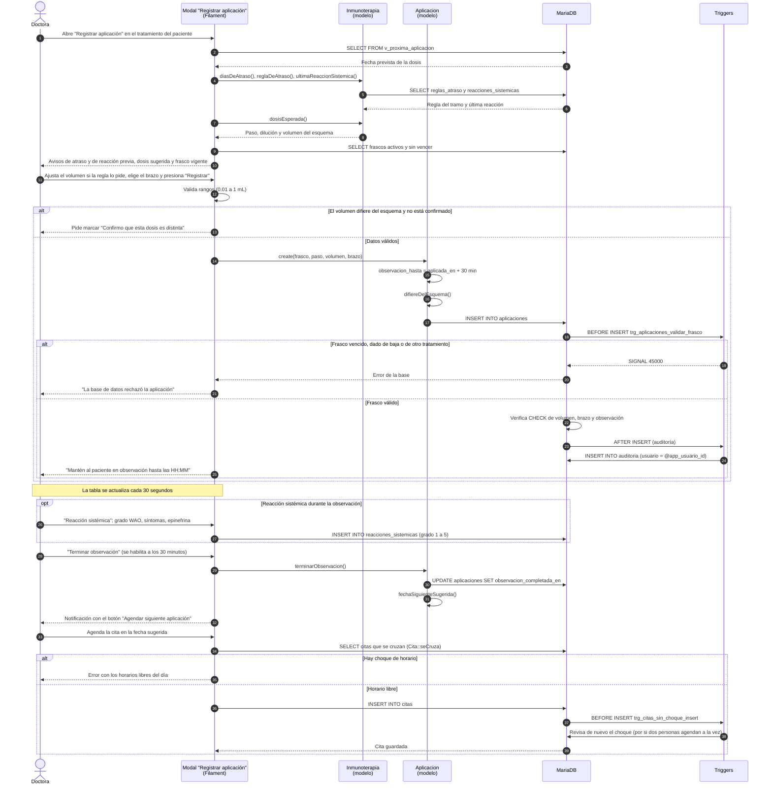

# Diagrama de secuencia · Aplicar una dosis de inmunoterapia (HU-11 a HU-14)

Desde que la doctora abre "Registrar aplicación" hasta que termina la observación y agenda la siguiente dosis.

**Puntos de seguridad en el flujo:**

1. Las reglas importantes se revisan dos veces: en el formulario, para dar un mensaje claro, y en la base con triggers y `CHECK`, por si alguien escribe directo en phpMyAdmin o dos personas guardan al mismo tiempo.
2. El usuario `mediagenda_app` no tiene `DELETE` sobre `aplicaciones`, `reacciones_sistemicas` ni `citas`: una dosis registrada no se puede borrar y una cita se cancela con motivo.
3. Cada aplicación, reacción y cita queda en la `auditoria` con el usuario que la registró.
