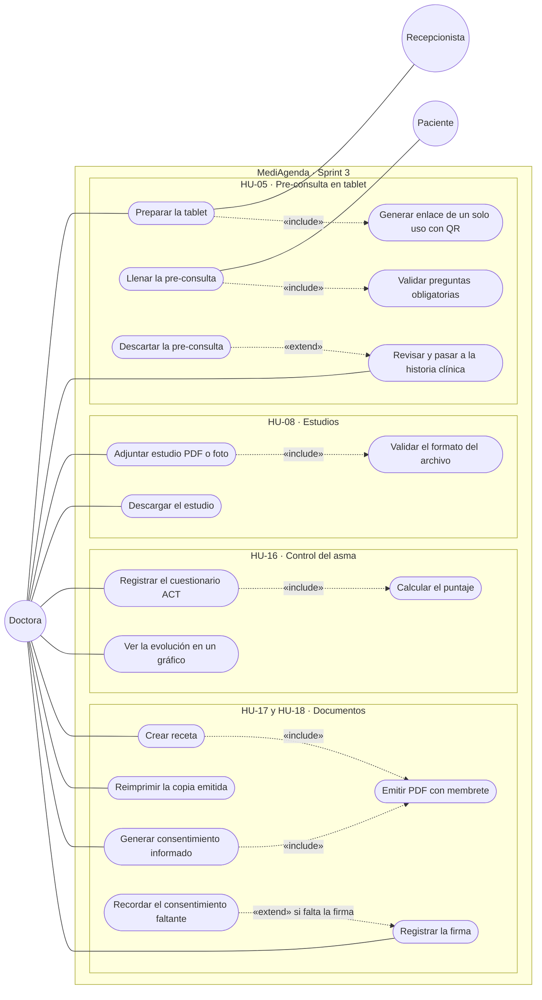

# Diagrama de casos de uso · Sprint 3

Historias HU-05, HU-08, HU-16, HU-17 y HU-18. Aparece un tercer actor, el paciente, que solo llega a su formulario de pre-consulta en la tablet y nunca al expediente.

| Caso de uso | Actor | Historia | Regla principal |
|---|---|---|---|
| Preparar la tablet | Recepcionista, doctora | HU-05 | El enlace sirve una vez, vence en 3 horas y se guarda solo como hash SHA-256 |
| Llenar la pre-consulta | Paciente | HU-05 | No inicia sesión; si el navegador tenía una sesión del personal, se cierra |
| Revisar la pre-consulta | Doctora | HU-05 | Las respuestas son borrador hasta que la doctora las acepta o corrige |
| Adjuntar estudio | Doctora | HU-08 | Solo PDF, JPG o PNG de hasta 10 MB; el archivo no se reemplaza |
| Registrar el ACT | Doctora | HU-16 | 5 respuestas de 1 a 5; la base calcula el puntaje (5 a 25) |
| Emitir PDF | Doctora | HU-17 | Folio correlativo y copia con huella SHA-256; lo emitido no se modifica |
| Reimprimir | Doctora | HU-17 | Se entrega la copia guardada, después de comprobar su huella |
| Generar consentimiento | Doctora | HU-18 | Apartados de la NOM-004: lugar y fecha, riesgos, beneficios, firmas y testigos |
| Recordar el consentimiento | Doctora | HU-18 | Aviso al registrar una aplicación o un prick test sin consentimiento firmado |
