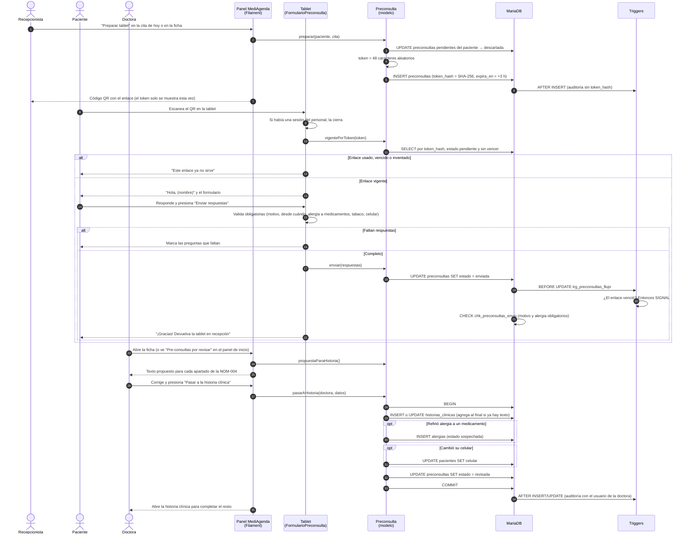

# Diagrama de secuencia · Pre-consulta en tablet (HU-05)

Desde que la recepción prepara la tablet hasta que la doctora pasa las respuestas a la historia clínica.

**Puntos de seguridad en el flujo:**

1. El paciente no tiene usuario: el enlace es el permiso. Sirve una sola vez, vence en 3 horas, la ruta acepta solo tokens de 48 caracteres y tiene un límite de 30 peticiones por minuto.
2. La base guarda solo el hash SHA-256 del token, y la auditoría nunca lo copia. Quien lea la tabla no puede abrir el formulario.
3. La recepción prepara la tablet, pero no puede ver las respuestas: solo la doctora las revisa.
4. Una pre-consulta revisada o descartada ya no se modifica: lo impide el trigger `trg_preconsultas_flujo`.
